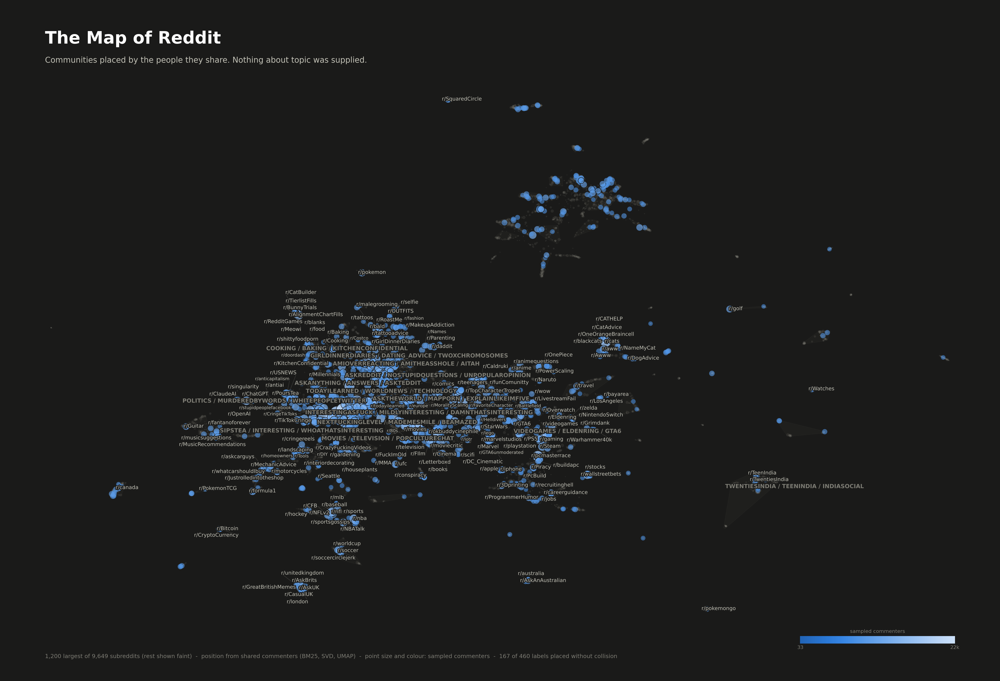

# The Map of Reddit

A map of **9,649 subreddits** positioned **only by which people comment in them**.
No topic, title, description, or text content is given to the model. Communities
that share an audience end up near each other, so the map's structure is a
finding rather than an input.



## The idea

If you and I both comment in `r/rust` and `r/SteamDeck`, that is one weak piece of
evidence that those two communities draw on a common population. Aggregate enough
of those coincidences and the geometry of Reddit falls out on its own: sports
cluster with sports, national subreddits cluster with their own language,
programming languages sit beside the tools they are used with.

## The one decision that made this work

The obvious approach is subreddit-first: pull a few thousand comments per
subreddit and record who showed up. Measured on a 20-subreddit pilot, this gives
a **very** thin matrix:

```
total unique authors : 45,120
in >=2 subreddits    :  2,580  (5.7%)   <- the only rows carrying signal
in >=5 subreddits    :     29
```

94% of the sampled authors appeared in exactly one subreddit and contributed
nothing to any co-occurrence. Each request bought roughly one sparse cell.

Asking the API **author-first** inverts the economics. One request for a single
author's recent comments returns their whole portfolio:

```
phil_the_builder    100 comments -> 42 subreddits
SaltyShawarma       100 comments -> 29 subreddits
IceSentry           100 comments -> 36 subreddits
```

One request now buys a complete co-occurrence *row* instead of one cell. Same
request budget, roughly two orders of magnitude more signal. Subreddit-first
sampling is still used, but only as a seeding step to discover a diverse author
population.

## The second decision: the seed list was never the map

The seed list existed only to discover a diverse author population. Once 57,450
author profiles were in hand, they turned out to mention **105,586 distinct
subreddits** -- and the build step was throwing away all but the original 1,000:

```
distinct subreddits seen : 105,586
  of which in seed list  :   1,000
  NOT in seed list       : 104,586   <- discarded at build time
```

Keeping everything with at least 30 sampled commenters gave **9,587 subreddits
from round one alone, a ~10x larger map for zero additional comment fetching**
(9,649 once the round-two pool below is included). It is also what puts
niche communities on the map at all: r/rust has 110 sampled commenters, plenty to
place, but 333k subscribers put it far below the seed list's ~1.1M floor.

What the expansion *did* require was metadata (`src/fetch_meta.py`, ~13 minutes).
Not for subscriber counts, which are optional, but for `over18`: **1,530 of the
newly mapped subreddits are adult**, and without those flags the neutral-labelling
rule would have failed open on exactly the communities it exists to handle.

## The third decision: the author pool was biased, and it mattered

Round one sampled its authors entirely from the top 1,000 subreddits. Anyone who
never comments in a large community was invisible, so niche subreddits were
positioned largely through whichever mainstream subs their members happened to
share. Round two re-sampled authors stratified over **all 9,649 mapped
subreddits** (`fetch_authors.py --source atlas`, then `fetch_temporal.py`).

| | round 1 | round 1 + 2 |
|---|---|---|
| authors | 56,141 | **84,593** |
| nonzeros | 1.26M | **2.01M** |
| median commenters per subreddit | 63 | **108** |
| mean placement confidence | 0.414 | **0.520** |

The confidence gain is the point: the same bootstrap that scored the old map at
0.414 scores the debiased one at 0.520, a 26% improvement in how reproducible
placements are. Pass `--round1-only` to rebuild the biased version for comparison.

## Time: what actually moved

`fetch_temporal.py` samples each author once per period, so the same people are
measured in both windows and a change is a change in where *they* went, not an
artefact of surveying two different populations.

Two things make the comparison honest.

**Both periods are embedded once, together.** Each subreddit contributes two rows
to a single matrix, over a shared author vocabulary: one BM25, one SVD, one UMAP.
Two independently fitted embeddings would not be comparable at all, because UMAP
is free to rotate, reflect and rescale.

**Drift is measured against each community's own noise.** The floor comes from
resplitting a period's own comments binomially between two replicates over the
identical author columns, which is what "same people, sampled differently" looks
like. It is computed per subreddit, because a thinly sampled community is noisy
on its own terms.

Two bugs were found and fixed here, both of which would have produced confident
nonsense:

1. The first null used two **disjoint** halves of authors. Disjoint author sets
   share no columns, so the halves came out near-orthogonal by construction and
   the floor landed at 0.97 cosine, above every real signal.
2. The floor was then collapsed to a single global median, which simply ranked
   the thinnest subreddits to the top. Per-subreddit floors fixed it.

With both fixed, **1,702 of 2,852 comparable subreddits** moved at least twice
their own sampling noise, and the top movers are recognisable real events that
nothing in the pipeline was told about:

```
r/HollowKnight   72x   Silksong shipped in 2025
r/Silksong       60x
r/Battlefield    33x   -> gained r/Battlefield6
r/Nightreign     22x
r/BlueskySkeets  22x   -> gained r/somethingiswrong2024, r/inthenews
```

### Why there are no arrows on the map

The obvious temporal visual is a quiver plot from each subreddit's period-one
position to its period-two position. It would be a lie. The correlation between a
subreddit's real drift and its 2-d displacement is **0.041**. Both period-rows of
a subreddit are near-identical, so UMAP drops them almost on top of each other and
whatever separation survives is projection jitter. Change is therefore shown where
it is real, in the neighbourhood, as a ranked chart against the noise floor.

## Pipeline

| Stage | Script | What it does |
|---|---|---|
| 1 | `src/fetch_seeds.py` | Rank subreddits by subscribers via `min_subscribers`, paging with `max_subscribers` as a descending cursor |
| 2 | `src/fetch_authors.py` | Seed sweep: sample commenters per subreddit across 6 monthly slices |
| 3 | `src/fetch_profiles.py` | **The main pass.** Stratified author sample, one request each, returns cross-subreddit activity |
| 3b | `src/fetch_meta.py` | Subscriber counts and `over18` for every subreddit the profiles revealed |
| 3c | `src/fetch_temporal.py` | Debiased round-two pool, sampled once per period |
| 4 | `src/build_atlas.py` | Incidence matrix, BM25, truncated SVD, UMAP, HDBSCAN |
| 4b | `src/build_temporal.py` | Joint two-period embedding, per-community noise floor |
| 5 | `src/validate.py` | Split-half stability, trustworthiness, weighting ablation |
| 6 | `src/confidence.py` | Bootstrap per-subreddit placement confidence |
| 7 | `src/neighbors.py` | Top-k neighbours from the 128-d space |
| 8 | `src/render_atlas.py` | Poster PNG and region facet sheet |
| 9 | `src/render_html.py` | Self-contained zoomable HTML map |
| 9b | `src/render_temporal.py` | Movers ranking and drift-vs-noise scatter |

Stages 6 and 7 write into `atlas.json`, so they must run **after** `build_atlas.py`
and before the renderers. Re-running the build resets both, so a rebuild always
needs `confidence.py` and `neighbors.py` re-run behind it or the map loses its
confidence shading and its neighbour panel.

### Weighting: a claim this project got wrong

Some weighting is clearly needed. On raw counts every community looks similar to
`r/AskReddit`, because a large share of *any* author sample comments there, and
the map collapses toward one hub.

This originally used **PPMI**, on the reasoning that dividing out base rates
leaves only surprising association. That reasoning was asserted here as fact and
never tested. When it finally was (`src/validate.py`), it did not survive.

On 18 deliberately unarguable subreddit pairs, scored by where each partner ranks
in the other's neighbour list:

| weighting | split-half agreement | median partner rank | pairs in top 10 |
|---|---|---|---|
| raw counts | 0.331 | 22 | 6/18 |
| log1p | 0.331 | 22 | 6/18 |
| PPMI | 0.423 | **26** | 8/18 |
| **BM25** | **0.444** | **4** | **11/18** |

(Numbers from the final debiased data. The original round-one run showed the same
verdict with a wider gap: PPMI median rank 30 against BM25's 2, so the conclusion
replicates independently on both datasets.)

PPMI ranked *worse than doing nothing at all* on the pair test. The cause is
over-correction: dividing out popularity punishes pairs that are related **and**
both large.

```
                          PPMI    BM25
r/gaming / r/videogames    414      21
r/StarWars / r/Marvel      321      28
r/Overwatch / r/lol        183      49
r/cats / r/aww             102       1
```

BM25's frequency saturation is gentler, and its IDF term damps ubiquitous
subreddits without erasing association between popular ones. It won both metrics,
so it is now the default. PPMI is still available via `--weight ppmi`, and
`validate.py` will re-derive the whole table.

## Does the map mean anything?

`src/validate.py` tries to break it. Three results, all reproducible:

**Split-half stability.** Build the representation twice from disjoint halves of
the authors and compare neighbourhoods. Mean Jaccard **0.423** against a chance
baseline of 0.0026, a **163x lift**. The structure is real, not sampling noise.

Agreement tracks evidence, exactly as it should:

| subset | neighbour agreement | median sampled commenters |
|---|---|---|
| thinnest 25% | 0.347 | 59 |
| middle 50% | 0.422 | 108 |
| densest 25% | 0.500 | 322 |

**Projection fidelity.** UMAP squeezes 128 dimensions into 2, and that is lossy.
Trustworthiness at k=25 is **0.939**, so the picture can be read fairly literally
-- neighbourhoods you see are overwhelmingly real ones.

**The ablation** above, which is how the PPMI claim got corrected.

## Knowing what the map does not know

`src/confidence.py` resamples the authors with replacement, rebuilds the
representation six times, and scores each subreddit by how much its neighbour set
survives. That per-subreddit number is written back into the atlas and used:

- Mean confidence **0.520**, median **0.524**.
- **851 subreddits (8.8%) still score below 0.25** (it was 24% before the author
  pool was debiased). These are real communities but loosely sited, and the map
  says so rather than pretending otherwise.
- Weakly placed marks are drawn **fainter**, and the weakest are **not labelled
  at all** on the poster. Naming a community asserts it sits where the map put
  it; for those, that assertion is not supported.
- The interactive map reports it in plain words on click: "placement well
  constrained / moderate / weak / very weak".

### Sampling notes

- Commenters are sampled across **monthly slices**, not one contiguous block. A
  contiguous block is often dominated by two or three megathreads, which makes the
  author set describe an event rather than a community.
- The author sample is **stratified per subreddit**. Pooling globally would draw
  overwhelmingly from the defaults and leave niche communities as noise.
- Deleted accounts and site-wide bots are dropped; they would otherwise link every
  subreddit to every other one.
- Authors active in more than 60 of the mapped subreddits are dropped for the same
  reason.

## Design of the map

Colour here is deliberately **not** used for cluster identity. A scatter plot is
gated on all-pairs colour separation, and only three categorical hues clear that
bar; a 40-colour cluster map would fail it and be unreadable besides. So:

- **Position and direct labels carry identity.** Regions are named typographically
  after their largest members.
- **Colour carries one thing only:** sampled commenters, on a single sequential
  ramp with a real legend. Sampled commenters rather than subscribers: it is
  complete for every mapped subreddit, it measures activity instead of dormant
  sign-ups, and it is the same quantity position is derived from.
- **The bottom of the ramp is clipped.** A sequential ramp is designed to let its
  lowest step recede toward the surface, which is right for magnitude but wrong
  for a map, where every point is a place. Below a floor, ~90% of the marks were
  invisible.
- **Small communities recede, they do not compete.** At ~10k points, sizing every
  mark comparably turns the core into mud, so mark size and opacity give the map
  depth.
- **Per-region detail moves to a facet sheet**, where each panel highlights one
  region against muted context. One series per panel means no colour pair is ever
  on screen together.

Labels are placed greedily with collision rejection and dropped when nothing fits;
the footer reports how many of the attempted labels actually landed.

**Label geometry runs entirely in display space.** The first version measured text
in pixels but tested collisions in data units. Because the axes are not square in
data terms, the horizontal and vertical offsets were scaled differently, candidate
positions landed somewhere other than intended, and nearly everything collided:
**26 of 260 labels placed**, with several labels stranded far from the point they
named. Doing all the geometry in one coordinate system, with candidates tried on
rings of increasing radius, took that to **139 of 260** with leader lines drawn
whenever a label ends up far enough away to be ambiguous.

## Running it

```bash
pip install requests numpy scipy scikit-learn umap-learn matplotlib
```

```bash
python src/fetch_seeds.py --target 1000 --min-subs 150000
python src/fetch_authors.py --slices 6 --pages 1
python src/fetch_profiles.py --per-sub 60 --max-authors 60000
python src/fetch_meta.py --min-authors 30
python src/build_atlas.py                       # BM25 by default
python src/validate.py                          # optional, ~3 min
python src/confidence.py --reps 6               # writes confidence into atlas
python src/neighbors.py --k 8                   # writes neighbours into atlas
python src/render_atlas.py --mode dark --top 1200
python src/render_atlas.py --mode dark --top 2000 --crop 3 97 --out-suffix _core
python src/render_html.py

# temporal
python src/build_temporal.py --min-authors 40 --null-reps 3
python src/render_temporal.py --mode dark --top 26
```

Every fetch stage is resumable, so an interrupted run can be restarted with the
same command and will skip what it already has.

## Data source

> The raw inputs are not in this repository. [DATA.md](DATA.md) records exactly which files were used, with sizes and fingerprints, and how to re-fetch them.

[Arctic Shift](https://arctic-shift.photon-reddit.com/), a public Reddit archive.
No credentials required. Limits observed in practice: 100 results per request,
~13 requests/second sustained at 12 concurrent workers. The API answers
over-broad queries with HTTP 200 and `{"data": null, "error": "Timeout..."}`, so
the client treats a 200 as insufficient evidence of success and inspects the body.

## Interactive map

`output/atlas.html` is self-contained and needs no server.

- Scroll or pinch to zoom, drag to pan, click any community for its **nearest
  neighbours in the 128-d space** (not the projected 2-d ones) and its placement
  confidence in plain words.
- Deep links: the view, search and selection round-trip through the URL hash, so
  a particular view can be shared.
- Touch is supported: one finger pans, two pinch.
- Hit testing uses a uniform spatial grid (~2 microseconds per pick) rather than
  a linear scan, and per-point colours are precomputed, which took a pan frame
  from 60 ms to 27 ms at 9,649 points.

## Caveats

- Subreddits are sampled, not censused. Position is an estimate, and the smallest
  subreddits on the map are placed from the fewest observations.
- Every mapped subreddit has at least 30 sampled commenters. Those near the floor
  are placed from far fewer observations than the giants and should be read as
  rough placements.
- The poster and the interactive map serve different purposes. ~9.6k points is
  more than a static image can label: only ~120 labels fit without collision, and
  that ceiling is set by canvas area, not by the data. The poster therefore draws
  the 1,200 largest communities at full weight (`--top 1200`) with the remaining
  8,387 as faint context, so the shape all 9,587 produce is still visible while
  the labelled layer stays legible. Positions always come from the full
  embedding; `--top` only governs what is drawn heavy and what may be labelled.
  Pass `--top 0` for the undifferentiated version. The HTML map keeps all 9,587
  and reveals labels progressively as you zoom.
- UMAP distances are not metric. Neighbourhoods are meaningful; absolute distances
  across the map are not.
